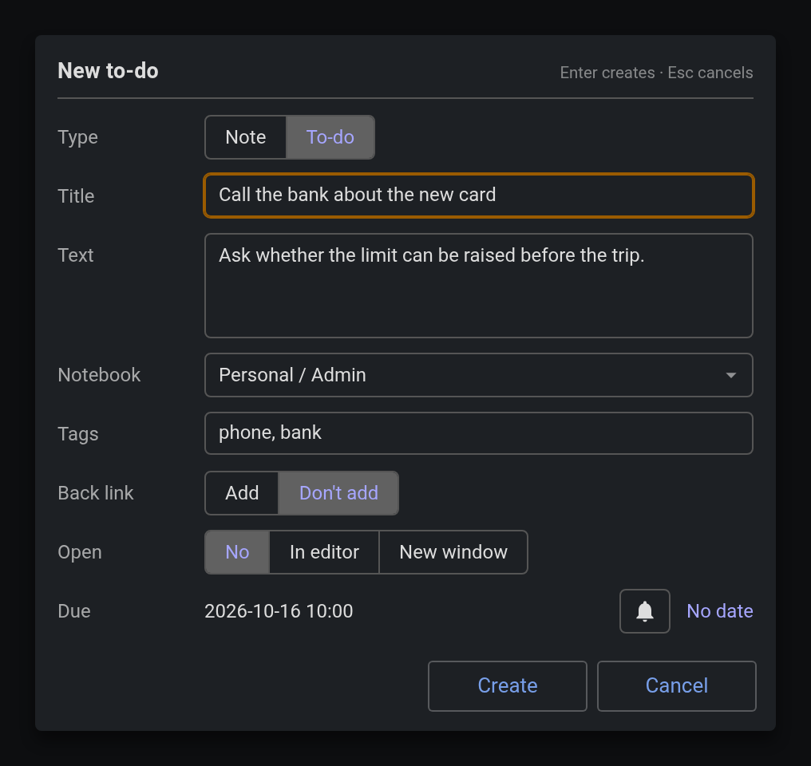
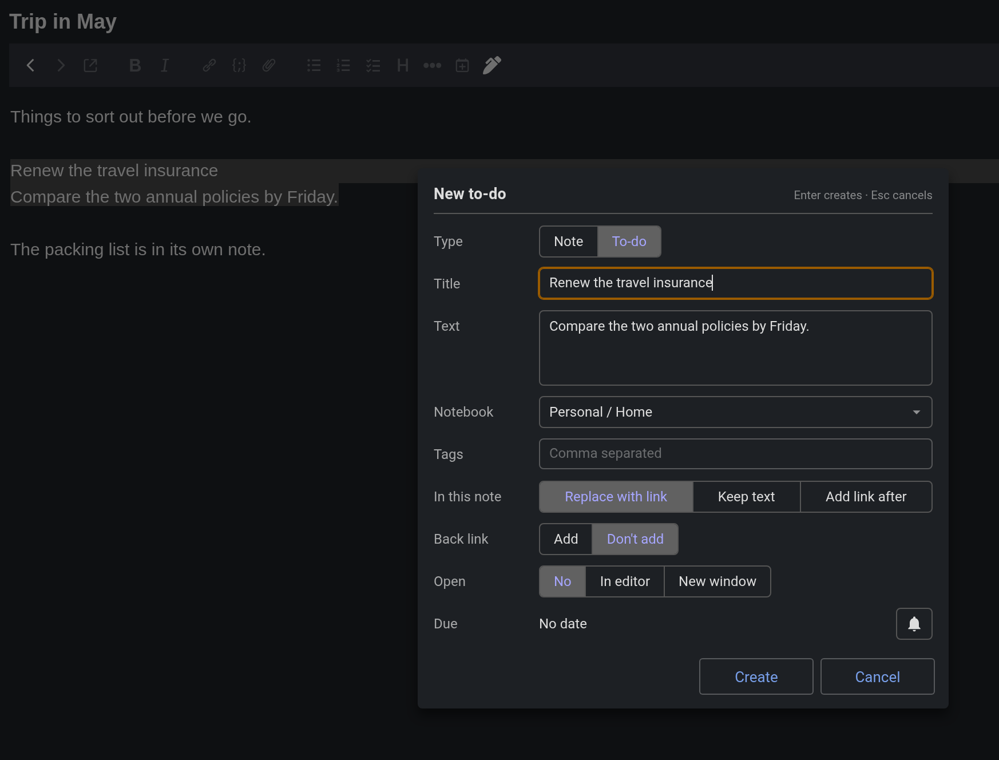
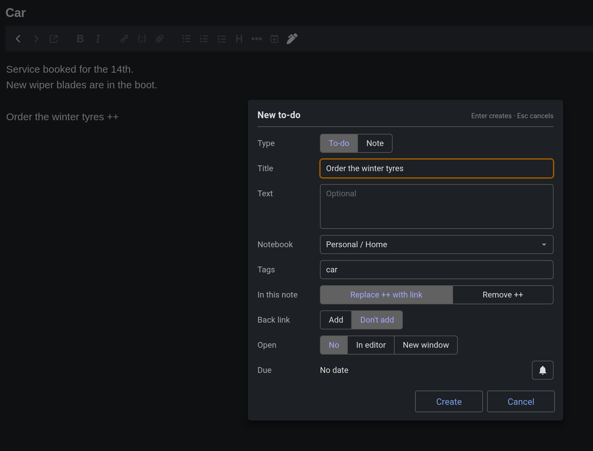
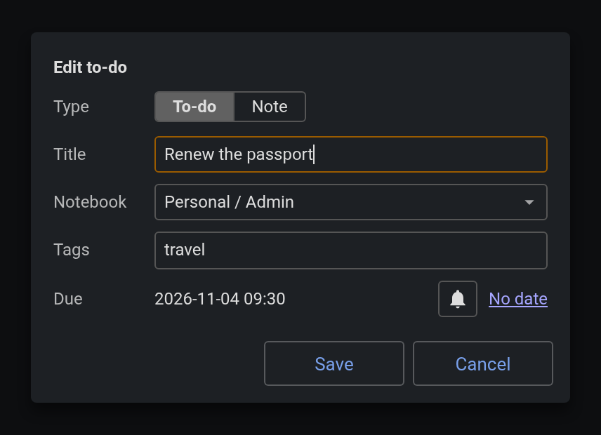
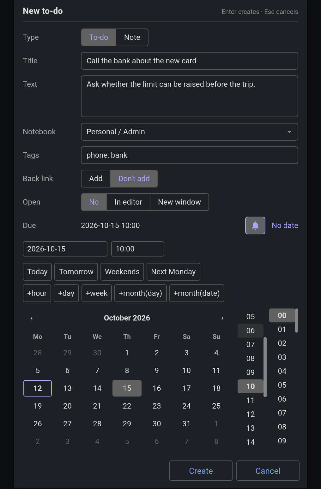

# Jot

Quick capture of a note or to-do without leaving the one you are in.



While you read or work in one note, Jot opens a small form for the title, a line or two of text, the notebook, tags and the due date, creates the note from it, and does not open it. You stay where you were. Joplin's own New note and New to-do create an empty note and open it, and Back lands at the top of the note you were reading; Jot exists so that never happens.

0.1.0 is the first release. The desktop is tested; Android is not yet, see the known limits below.

## Install

In Joplin, Settings › Plugins › search for Jot and install it. Or download `io.github.pmslava.jot.jpl` from the [releases page](https://github.com/pmslava/joplin-plugin-jot/releases) and use Settings › Plugins › Install from file.

## Ways in

- **Tools › Jot…**, with `Ctrl+Shift+J` as its shortcut on every platform (change it under Options › Keyboard Shortcuts).
- **Jot from the selection…** in the editor's right-click menu. The first line of the highlighted text becomes the title and the rest the text. The shortcut does the same when text is highlighted.

  

- **Typing `++`** at the start of a line or after a space in the Markdown editor. The trigger is a setting; empty turns it off. It never fires inside a word (`C++`), on a paste, or twice for the same occurrence: cancel the form once and that `++` is left alone.

  

- **The Jot button** in the note toolbar, the feather icon.
- **Edit with Jot…** in the note list's right-click menu: the same form prefilled with the note's title, type, notebook, tags and due date. Save writes only what you changed, and the note is never opened.

  

## The form

Type (To-do or Note), Title, Text, Notebook, Tags and Due. The title is focused when the form opens, so typing a title and pressing Enter is all a capture needs. Notebook and Tags filter a list as you type, and Enter picks the highlighted row; the notebook starts on the one you are in. Due shows the date and time beside a bell; the bell unfolds Cockpit's date picker, the calendar, the time columns and the quick buttons, and every pick writes into the row at once. A to-do whose date is picked before its time starts at the day start time.



**Create** writes the note and stays where you are. **Create and open** opens it, in the editor or in a new window by setting. A form with no title and no text creates nothing. An empty title with text takes the first line of the text as the title.

When the form was opened from highlighted text, an **In this note** row asks what to do with that text: replace it with a link to the new note (the default), keep it, or add a link after it. When it was opened by `++`, the row asks whether to replace the `++` with the link (the default) or remove it. Jot remembers your last choice for each.

## Settings

Settings › Plugins › Jot: what Jot creates by default (a to-do or a note), where Create and open opens the note (the editor, or a new window on desktop), the typed trigger, the day start time, and whether the toolbar button is shown (after a restart, since Joplin cannot add or remove a toolbar button while running).

## Known limits of 0.1.0

- Nothing has been checked on Android yet. The plugin installs there, but the form, the toolbar button and the trigger are untested on a phone.
- In the Rich Text editor the typed trigger does not work (no plugin code runs there), and "Add a link after it" is not offered; the shortcut and the right-click entry work, and "Replace it with a link" writes the link as HTML.
- The trigger ignores Markdown context: `++` after a space fires inside a code block too. Cancel once and that occurrence is left alone.
- When the note list shows **All notes**, Joplin answers a new tag by selecting the note at the top of the list, which is the note Jot has just created. Jot notices and opens the note you were reading again, at the same scroll position and caret in the Markdown editor. Joplin can only do that by showing the note's notebook, so the note list switches from All notes to that notebook.
- Cockpit calling Jot from its New note and New to-do buttons and its row menu comes in a later Cockpit version.

## For other plugins

`joplin.commands.execute('jot.open', args)`: with `{ mode: 'new', type, title, body, notebookId }` it opens the form with those presets and resolves `{ id, opened }`, or `null` on Cancel; with `{ mode: 'edit', noteId }` it opens edit mode and resolves `{ id, changed }`, the list of fields written, or `null`. With no arguments it behaves as the shortcut.

## Build from source

```bash
npm install
npm run dist
```

`npm test` runs the harness; `npm run test:e2e` runs the Playwright suite over an isolated Joplin AppImage under xvfb. The plugin file is `publish/io.github.pmslava.jot.jpl`.

## Credits

The idea of a note from highlighted text comes from Convert Text To New Note by ambrt. The capture use case comes from xiaofeng's request in the Cockpit forum thread. The date picker is Cockpit's. MIT.
